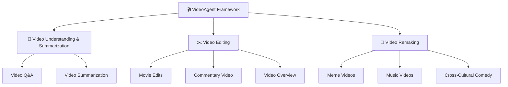

<div align="center">


<!-- # Open Agentic Video Intelligence -->
<br>

**🌟 包括的なビデオインテリジェンス：<br> 理解・編集・生成のためのオールインワンフレームワーク**

<div align="center">

</div>

<a href='https://space.bilibili.com/3546868449544308'></a>&nbsp;
<a href='https://www.youtube.com/@AI-Creator-is-here'></a>&nbsp;
<br>
<a href="./Communication.md"></a>
<a href="./Communication.md"></a>
<br>
<a href='https://arxiv.org/pdf/2606.23327'></a>
<br>
<a href="https://trendshift.io/repositories/18548" target="_blank"></a>

</div>

<div align="center">

[English](readme.md) | [简体中文](readme_zh.md) | [日本語](readme_ja.md)

</div>

---

## 📹 **デモ動画**
<div>
<a href="https://www.youtube.com/watch?v=JZkXO1NG2Ok" target='_blank'></a>
</div>

この動画では、VideoAgent を使って次のことを行う方法を紹介しています：
- ユーザーの要件を明確に言語化する
- 意図分析と、自律的なツール利用・計画を実現する
- 詳細なワークフローを含む、マルチモーダルな成果物を作成する
- 動画の概要を完全自動で生成する

## 🚀 主な機能

🧠 - **動画コンテンツの理解**<br>
高度なマルチモーダルインテリジェンス機能により、動画メディアの詳細な分析、要約、インサイトの抽出を可能にします。

✂️ - **動画クリップの編集**<br>
シームレスなワークフロー統合により、コンテンツの組み立て、切り出し、再構成を行う直感的なツールを提供します。

🎨 - **クリエイティブな動画のリメイク**<br>
生成技術を活用し、AI によるクリエイティブ支援で、想像力豊かな新しい動画コンテンツを制作します。

🔧 - **マルチモーダルなエージェントフレームワーク**<br>
複数の AI モダリティを組み合わせた統合フレームワークにより、パフォーマンスを高めた包括的なビデオインテリジェンスを提供します。

🚀 - **シームレスな自然言語体験**<br>
純粋な対話型 AI によって、動画とのやり取りや動画制作を一変させます。複雑なインターフェースや専門知識は不要で、VideoAgent と自然に対話するだけです。

 


</div>


<div align="center">
<table>
<tr>
<th align="center"> </th>
<th align="center">VideoAgent</th>
<th align="center">Director</th>
<th align="center">Funclip</th>
<th align="center">NarratoAI</th>
<th align="center">NotebookLM</th>
</tr>
<tr>
<td align="center">ビート同期編集</td>
<td align="center">✅</td>
<td align="center">✅</td>
<td align="center">✅</td>
<td align="center">—</td>
<td align="center">—</td>
</tr>
<tr>
<td align="center">ストーリーテリング動画</td>
<td align="center">✅</td>
<td align="center">—</td>
<td align="center">—</td>
<td align="center">—</td>
<td align="center">—</td>
</tr>
<tr>
<td align="center">動画の概要</td>
<td align="center">✅</td>
<td align="center">✅</td>
<td align="center">✅</td>
<td align="center">✅</td>
<td align="center">✅</td>
</tr>
<tr>
<td align="center">ミーム動画のリメイク</td>
<td align="center">✅</td>
<td align="center">—</td>
<td align="center">—</td>
<td align="center">—</td>
<td align="center">—</td>
</tr>
<tr>
<td align="center">楽曲のリミックス</td>
<td align="center">✅</td>
<td align="center">—</td>
<td align="center">—</td>
<td align="center">—</td>
<td align="center">—</td>
</tr>
<tr>
<td align="center">言語をまたぐ翻案</td>
<td align="center">✅</td>
<td align="center">—</td>
<td align="center">—</td>
<td align="center">—</td>
<td align="center">—</td>
</tr>
<tr>
<td align="center">動画 Q&A</td>
<td align="center">✅</td>
<td align="center">✅</td>
<td align="center">—</td>
<td align="center">—</td>
<td align="center">✅</td>
</tr>
<tr>
<td align="center">効果音ツール</td>
<td align="center">✅</td>
<td align="center">—</td>
<td align="center">—</td>
<td align="center">—</td>
<td align="center">—</td>
</tr>
</table>
</div>


---

## 📑 目次

- [🌟 システム概要](#システム概要)
- [🔧 評価](#評価)
- [🚀 クイックスタート](#クイックスタート)
- [🔮 デモ](#デモ)
- [💖 謝辞](#謝辞)


### 🔥 **なぜ VideoAgent なのか？**

| 🧠 **使いやすさ** | 🚀 **無限の創造性** | 🎨 **高品質** |
|:---:|:---:|:---:|
| 1つのプロンプトで動画を作成 | どんなアイデアからでも制作 | 人間並みの品質の動画制作 |
| アイデアをプロフェッショナルな動画に変換 | 独自のアイデアに合わせたワークフローを生成 | プロの基準を満たす動画を提供 |

---

## 🌟システム概要

本システムは、動画処理の自動化に向けて3つの重要なイノベーションを導入しています。**意図分析（Intent Analysis）** は、ユーザーのコマンドを超えて、明示的なサブ意図と暗黙的なサブ意図の両方を捉えます。**自律的なツール利用と計画（Autonamous Tool Use & Planning）** は、適応的なフィードバックループを備えたグラフベースのワークフロー生成によって、エージェントのオーケストレーションを自動化します。**マルチモーダル理解（Multi-Modal Understanding）** は、生の入力を意味的に整合した視覚クエリに変換し、検索精度を高めます。

### 🧠 **意図分析**

- 🔍 VideoAgent はユーザーの指示を **明示的なサブ意図と暗黙的なサブ意図の両方に知的に分解** し、ユーザーが明示的に述べていない微妙な要件まで捉えます。この高度な解析により、表面的なコマンドを超えたユーザーの目的を **包括的に理解** できます。

- 🎯 **意図からエージェントへのマッピング機構** によって、マルチエージェントフレームワーク内のどの機能が必要かを正確に特定します。この的を絞ったアプローチにより、不要な計算オーバーヘッドを避けながら関連するシステムコンポーネントを **効率的に起動** し、**最適なタスク実行** を実現します。

### 🔧 **自律的なツール利用と計画**

- ⚙️ **グラフベースのフレームワーク** が、ユーザーの意図を自動的に **実行可能なワークフロー** に変換します。システムは適切なエージェントを動的に選択し、最適な実行シーケンスを構築します。ノードはツールの機能を表し、エッジは複雑な動画タスクのためのワークフローの接続を定義します。

- 🔄 適応的なフィードバックループが、**2段階の自己評価** を通じて計画プロセスを継続的に改善します。これにより、堅牢な **自動意思決定** とシームレスな実行が保証されます。システムはタスクのライフサイクル全体を通じて **自己修正** を行い、パフォーマンスを最適化します。

### 🎬 **マルチモーダル理解**

- 📋 **Storyboard Agent** は、ユーザーの生の入力を **最適化された視覚クエリ** に変換します。まず、事前にキャプションが付けられた動画素材バンクを分析し、利用可能なリソースを把握します。この基礎的な分析により、クエリ処理に使えるコンテンツをシステムが正確に把握できます。

- 💡 次に、エージェントはユーザーの入力を、視覚的にも意味的にも整合した **細粒度のサブクエリ** に **分解** します。この高度な分解により、ユーザーの意図とデータベース内で最も関連性の高い視覚コンテンツを照合し、**動画検索の精度を向上** させます。

<div align="center">
    <br>
</div>

---

## 🔧評価
VideoAgent が主要な課題にどれだけ効果的に対処できるかを検証するため、複数の観点から広範な実験を行いました。

### ワークフロー構築による無限の創造性

自動ワークフロー構築を通じた VideoAgent の **無限の創造性** を評価するため、汎用的に適用できる5つのエージェントを3つのバックボーンモデルで比較しました。その結果、VideoAgent は Audio と Video のデータセットにおいて他のベースラインを大きく上回り、グラフ構造によるガイダンスと、専用の自己評価フィードバックに基づく自己反省を通じた **創造的なワークフロー生成能力** を示しました。さらに、VideoAgent は GPT-4o や Deepseek-v3 と比べて Claude 3.7 バックボーンの下でより優れた安定した **創造的パフォーマンス** を発揮する一方、他のベースライン手法はバックボーンによって性能が変動することも確認しました。これは、多様なユーザー要件に適応する多様で効果的なワークフローを自動構築することで **無限の創造性を引き出す** VideoAgent の能力を示しています。また、より高性能な LLM ほど深い理解を実現し、複雑なグラフベースのタスクに対してより堅牢な創造的ソリューションを提供します。

<div align="center">
    <br>
    <br>
</div>

### 優れたマルチモーダル理解

マルチモーダル理解の能力を検証するため、シャッフルしたキャプションクエリを用いたテキストから動画への検索実験を行いました。評価では、対応する視覚コンテンツを検索するモデルの能力を測るために3つの指標を使用しています。Recall は、検索されたクリップの中点を正解の位置と比較することで、シャッフルされた動画クリップを正しく並べ替えるモデルの能力を測定します。Embedding Matching ベースのスコアは、生成された動画と高レベルのキャプション要約との粗粒度の整合性を評価します。Intersection over Union は、検索された区間と正解区間の時間的な重なりを全体の範囲に対する比率として計算し、クリップ単位での時間的な整合精度を定量化します。実験結果から、本手法がより正確な動画セグメントを検索できることが示されており、精密なマルチモーダル理解能力を裏付けています。


<div align="center">
    <br>
</div>


### 反復を重ねるほど高いパフォーマンス

リフレクションのラウンド数がパフォーマンスに与える影響を分析し、VideoAgent の反復的な改善能力を調査しました。3つの LLM バックボーンを用いた2つのデータセットでのワークフロー構成に関する包括的なハイパーパラメーター実験を通じて、VideoAgent の **顕著な自己改善能力** を示しています。結果から、初期の反復ではベースライン程度の結果にとどまるものの、システムの **適応的なリフレクション機構** によってラウンドを重ねるごとに大幅な性能向上が得られることがわかりました。VideoAgent はテストしたすべての構成で **0.95 という一貫したワークフロー構成成功率** を達成しており、基盤となる LLM バックボーンにかかわらず、**堅牢な自己修正能力** と **信頼性の高い高品質な出力** を示しています。
<div align="center">
    <div style="display: flex; justify-content: center; width: 80%; flex-wrap: nowrap;">
        
	
    </div>
</div>

---

## 🚀クイックスタート

### 🖥️ **動作環境**

```
GPU Memory: 8GB  
OS: Linux, Windows
```

### 📥 **クローンとインストール**

```bash
git clone https://github.com/HKUDS/VideoAgent.git
conda create --name videoagent python=3.10
conda activate videoagent
conda install -y -c conda-forge pynini==2.1.5 ffmpeg
pip install -r requirements.txt
```

### 📦 **モデルのダウンロード**

```bash
# Download CosyVoice
cd tools/CosyVoice
huggingface-cli download PillowTa1k/CosyVoice --local-dir pretrained_models
```

```bash
# Download fish-speech
cd tools/fish-speech
huggingface-cli download fishaudio/fish-speech-1.5 --local-dir checkpoints/fish-speech-1.5
```

```bash
# Download seed-vc
cd tools/seed-vc
huggingface-cli download PillowTa1k/seed-vc --local-dir checkpoints
```

```bash
# Download DiffSinger
cd tools/DiffSinger
huggingface-cli download PillowTa1k/DiffSinger --local-dir checkpoints
```

```bash
# Download Whisper
cd tools
huggingface-cli download openai/whisper-large-v3-turbo --local-dir whisper-large-v3-turbo
```

```bash
# Make sure git-lfs is installed (https://git-lfs.com)
git lfs install
```

```bash
# Download ImageBind
cd tools
mkdir .checkpoints
cd .checkpoints
wget https://dl.fbaipublicfiles.com/imagebind/imagebind_huge.pth
```

**🌟 便利なように複数のモデルを用意しています。プロジェクトに関係するものだけをダウンロードしてもかまいません。**


<table>
  <tr>
    <th align="center">機能タイプ</th>
    <th align="center">デモ動画</th>
    <th align="center">必要なモデル</th>
  </tr>
  <tr>
    <td align="center">Cross Talk</td>
    <td align="center">英語のスタンダップコメディから中国語の相声へ</td>
    <td align="center">CosyVoice, Whisper, ImageBind</td>
  </tr>
  <tr>
    <td align="center">Talk Show</td>
    <td align="center">中国語の相声から英語のスタンダップコメディへ</td>
    <td align="center">CosyVoice, Whisper, ImageBind</td>
  </tr>
  <tr>
    <td align="center">MAD TTS</td>
    <td align="center">Xiao-Ming-Jian-Mo(小明剑魔) ミーム</td>
    <td align="center">fish-speech</td>
  </tr>
  <tr>
    <td align="center">MAD SVC</td>
    <td align="center">AI ミュージックビデオ</td>
    <td align="center">DiffSinger, seed-vc, Whisper, ImageBind</td>
  </tr>
  <tr>
    <td align="center">Rhythm</td>
    <td align="center">スパイダーマン：アクロス・ザ・スパイダーバース</td>
    <td align="center">Whisper, ImageBind</td>
  </tr>
  <tr>
    <td align="center">Comm</td>
    <td align="center">解説動画</td>  
    <td align="center">CosyVoice, Whisper, ImageBind</td>
  </tr>
  <tr>
    <td align="center">News</td>
    <td align="center">テックニュース：OpenAI の GPT-4o 画像生成のリリース</td>
    <td align="center">CosyVoice, Whisper, ImageBind</td>
  </tr>
  <tr>
    <td align="center">Video QA/Summarization</td>
    <td align="center">『デューン 砂の惑星 PART2』キャスト最新情報ポッドキャスト</td>
    <td align="center">Whisper</td>
  </tr>
</table>

</div>

### 🤖 **LLM の設定**

```bash
# VideoAgent\environment\config\config.yml
# Applicable scenarios and LLM configuration
# Claude is required as it powers the Agentic Graph Router 
llm:
  # Video Remixing/TTS/SVC/Stand-up/CrossTalk
  deepseek_api_key: ""  
  deepseek_base_url: ""  

  # Agentic Graph Router/TTS/SVC/Stand-up/CrossTalk
  claude_api_key: ""  
  claude_base_url: ""

  # Video Editing/Overview/Summarization/QA/Commentary Video
  gpt_api_key: ""  
  gpt_base_url: ""  

  # MLLM for caption and fine-grained video understanding
  gemini_api_key: ""  
  gemini_base_url: ""  
```

### 🎯 **使い方**

```bash
# With the configuration now complete, proceed to run the following instructions:
python main.py
# The console will output:
User Requirement: ...
# Requirement Example:
# 1. I need to create a reworded version of an existing video where the speech content is modified while maintaining the original speaker's voice. The video should have the same visuals as the original, but with updated dialogue that follows my specific requirements.
# 2. I have a standup comedy script that I'd like to turn into a professional-looking video. I need the script to be performed with good comedic timing and audience reactions, then matched with relevant video footage to create a complete standup comedy special. I already have a reference script and some footage I want to use for the video.
```
現在の LLM の選択は、各機能に合わせて最適化されています。

必要に応じて、`VideoAgent\environment\config\llm.py` でモデル名を調整することもできます。

---

## 🔮デモ

<table>
<tr>
<td align="center" width="33%">
<a href="https://www.bilibili.com/video/BV1C9Z6Y3ESo/" target='_blank'></a>
映画の編集
</td>
<td align="center" width="33%">
<a href="https://www.bilibili.com/video/BV1ucZ6YmEBU/" target='_blank'></a>
ミーム動画
</td>
<td align="center" width="33%">
<a href="https://www.bilibili.com/video/BV1t8ZCYsEeA/" target='_blank'></a>
ミュージックビデオ
</td>
</tr>
<tr>
<td align="center" width="33%">
<a href="https://www.bilibili.com/video/BV1ucZ6YmESg/" target='_blank'></a>
話芸（コメディ）
</td>
<td align="center" width="33%">
<a href="https://www.bilibili.com/video/BV1TmZ6YjEvV/" target='_blank'></a>
解説動画
</td>
<td align="center" width="33%">
<a href="https://www.bilibili.com/video/BV12mZ6YLEqW/" target='_blank'></a>
動画の概要
</td>
</tr>
</table>

デモの使い方の詳細については、以下を参照してください：  
👉 [デモドキュメント](demos_documents.md)


Bilibili チャンネルでは、さらに楽しい動画をご覧いただけます：  
👉 [Bilibili ホームページ](https://space.bilibili.com/3546868449544308)  
ほかにも楽しいコンテンツがありますので、ぜひチェックしてください！ 😊


**注意**：すべての動画は研究およびデモンストレーションの目的にのみ使用しています。音声および映像素材はインターネットから入手したものです。知的財産権を侵害しているコンテンツがあるとお考えの場合は、ご連絡ください。

---

## 💖**謝辞**

VideoAgent の実現に貢献してくださった多くの個人や組織に、心より感謝申し上げます。このフレームワークは巨人の肩の上に立っており、オープンソースコミュニティの集合知と、世界中の研究者による画期的な研究の恩恵を受けています。

### 🔧 **オープンソースコミュニティとサービスプロバイダー**

- [CosyVoice](https://github.com/FunAudioLLM/CosyVoice)
- [Fish Speech](https://github.com/fishaudio/fish-speech)
- [Seed-VC](https://github.com/Plachtaa/seed-vc)
- [DiffSinger](https://github.com/MoonInTheRiver/DiffSinger)
- [VideoRAG](https://github.com/HKUDS/VideoRAG)
- [ImageBind](https://github.com/facebookresearch/ImageBind)
- [Whisper](https://github.com/openai/whisper)
- [Librosa](https://github.com/librosa/librosa)


### 🎨 **コンテンツクリエイターとインスピレーション**

私たちの研究は、さまざまなプラットフォームのコンテンツクリエイターによる創造的な貢献によって大きく豊かなものになりました。以下の方々に感謝します：

- 🎬 **コンテンツクリエイター**：テストやデモンストレーションに使用したオリジナル動画コンテンツを制作した才能あるクリエイターの皆さん
- 🎭 **コメディアーティスト**：異文化間の翻案に着想を与えてくれた作品を生み出した皆さん  
- 🎥 **映画制作者**：デモで取り上げた映画やテレビ番組の制作チームの皆さん

**⚠️ 注意**：デモで使用しているすべてのコンテンツは研究目的のみに使用しています。私たちはすべてのコンテンツクリエイターの知的財産権を深く尊重しており、コンテンツの使用に関する懸念やフィードバックを歓迎します。

---

<div align="center">

</div>
